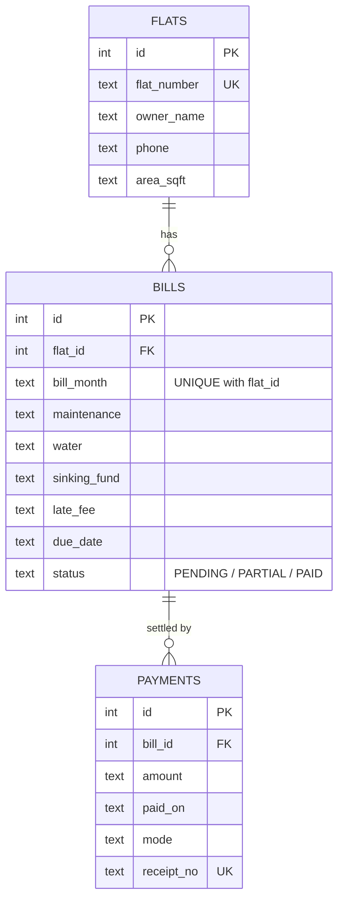

# Society Maintenance Bill Calculator

A Java 17 application that automates monthly maintenance billing for an apartment society: it generates bills for every flat, tracks full and partial payments, calculates late fees, reports pending dues and issues PDF receipts. Data is stored in SQLite through plain JDBC, and the code is split into model, repository, service and CLI layers.

   

## Features

| Feature | What it does |
|---|---|
| Flat management | Register flats with owner, phone and built-up area; duplicate flat numbers are rejected |
| Monthly bill generation | One bill per flat: `area x rate/sq ft + water + sinking fund`. Re-running a month only bills flats that don't have a bill yet |
| Payment tracking | Cash, UPI, card, cheque or bank transfer. Partial payments are supported; status moves `PENDING -> PARTIAL -> PAID` |
| Late fees | Grace period, then a fixed amount per late day, capped at a percentage of the bill. The fee is frozen on the bill when payments are made |
| Pending dues report | All unpaid and part-paid bills with late fee, amount paid, outstanding balance and days overdue |
| Collection summary | Billed vs collected vs pending for any month |
| PDF receipts | One-page receipt per payment with the full charge breakdown (OpenPDF) |
| Validation & errors | Central `Validator` and a custom exception hierarchy; the CLI shows friendly messages instead of stack traces |

## Architecture

```
            +------------------+
            |   App (CLI)      |   menu loop, input parsing, printing
            +--------+---------+
                     |
            +--------v---------+
            |  service layer   |   FlatService, BillingService, PaymentService,
            |                  |   ReportService, ReceiptService
            |  BillingCalculator (pure rules, no I/O)  <-- unit tested in isolation
            +--------+---------+
                     |
            +--------v---------+
            | repository layer |   FlatRepository, BillRepository, PaymentRepository
            +--------+---------+   (JDBC, PreparedStatements, SQLException -> DataAccessException)
                     |
            +--------v---------+
            |  SQLite (file)   |   schema created automatically on first run
            +------------------+
```

Design choices worth knowing:

* **Pure billing logic.** `BillingCalculator` has no database or I/O dependency, so every rule (due-date clamping, grace period, cap, status) is tested with plain JUnit.
* **Money is `BigDecimal`**, always at 2 decimal places, stored as text in SQLite to avoid floating-point drift.
* **Transactions.** Recording a payment inserts the payment and updates the bill's late fee and status in one transaction, so a failure never leaves them out of sync.
* **No JDBC leakage.** Repositories translate `SQLException` into `DataAccessException`; services and the CLI only see application exceptions.
* **Configurable rules.** Rates, due day, grace days and late-fee settings live in `application.properties`, not in code.

## Database schema



## Billing rules

Defaults live in `src/main/resources/application.properties`:

| Setting | Default | Meaning |
|---|---|---|
| `billing.rate.per.sqft` | 2.50 | Maintenance = flat area x rate |
| `billing.water.charge` | 200.00 | Fixed monthly water charge |
| `billing.sinking.fund` | 500.00 | Fixed monthly sinking fund |
| `billing.due.day` | 10 | Due date each month (clamped for short months) |
| `billing.grace.days` | 5 | No late fee until this many days after the due date |
| `billing.late.fee.per.day` | 10.00 | Charged per day after the grace period |
| `billing.late.fee.cap.percent` | 25 | Late fee never exceeds this % of the bill |

Worked example: a 1,000 sq ft flat gets `2,500 + 200 + 500 = Rs. 3,200`. Due on the 10th, grace until the 15th. Paying on the 25th means 10 chargeable days, so the late fee is `10 x 10 = Rs. 100`. The cap would be `25% of 3,200 = Rs. 800`.

## Getting started

**Prerequisites:** JDK 17+ and Maven 3.8+.

```bash
git clone https://github.com/<your-username>/society-maintenance-billing.git
cd society-maintenance-billing

mvn clean package          # compiles, runs the tests, builds target/maintenance-billing.jar
java -jar target/maintenance-billing.jar
```

Choose **9 - Load demo data** for 5 flats, two months of bills and sample payments, then try the reports. The SQLite file `society.db` and the `receipts/` folder are created in the directory you run from.

Run only the tests: `mvn test`

## Sample session

```
=== Society Maintenance Bill Calculator ===
Choose an option: 6
PENDING DUES REPORT (as of 2026-10-19)
Flat     Owner              Month    BillId       Charges    LateFee         Paid  Outstanding  Days
--------------------------------------------------------------------------------------------------------
A-102    Priya Nair         2026-08  2           3,700.00     650.00     1,500.00     2,850.00    70
A-102    Priya Nair         2026-09  7           3,700.00     340.00         0.00     4,040.00    39
B-201    Arun Sharma        2026-09  8           4,450.00     340.00         0.00     4,790.00    39
B-202    Meena Iyer         2026-08  4           3,450.00     650.00         0.00     4,100.00    70
...
Total outstanding: Rs. 30,960.00 across 7 bill(s)
```

## Screenshots

Add your own after running the app (see the checklist below):

| Pending dues report | Payment & receipt number | PDF receipt |
|---|---|---|
|  |  |  |

## Tests

| Test class | Covers |
|---|---|
| `BillingCalculatorTest` | maintenance maths, due-date clamping, grace period boundary, per-day late fee, cap, frozen fee on paid bills, status rules, config validation |
| `ValidatorTest` | flat number, phone, amount, month/date and id validation |
| `MaintenanceWorkflowTest` | end-to-end on a real temporary SQLite DB: bill generation, duplicate protection, partial and late payments, overpayment rejection, pending report, collection summary, PDF receipt |

## Project structure

```
src/main/java/com/society/maintenance/
  App.java                CLI entry point
  model/                  Flat, Bill, Payment (records) + BillStatus, PaymentMode
  repository/             Flat/Bill/Payment repositories (JDBC)
  service/                BillingCalculator, BillingConfig, Flat/Billing/Payment/Report/Receipt services
  exception/              SocietyException + specific subclasses
  util/                   Database (schema + transactions), Validator, Money
src/main/resources/       application.properties
src/test/java/...         JUnit 5 tests
```

## Possible extensions

* Spring Boot REST API (the service layer can be reused as-is) and a small React/Thymeleaf front end
* Email/SMS reminders for overdue bills
* Role-based login for admin vs residents
* CSV/Excel export of reports
* Docker image and GitHub Actions CI (`mvn verify`)

## License

MIT
